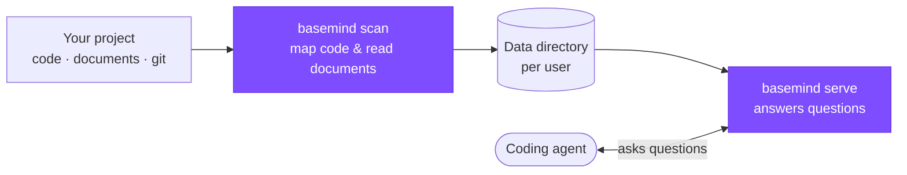
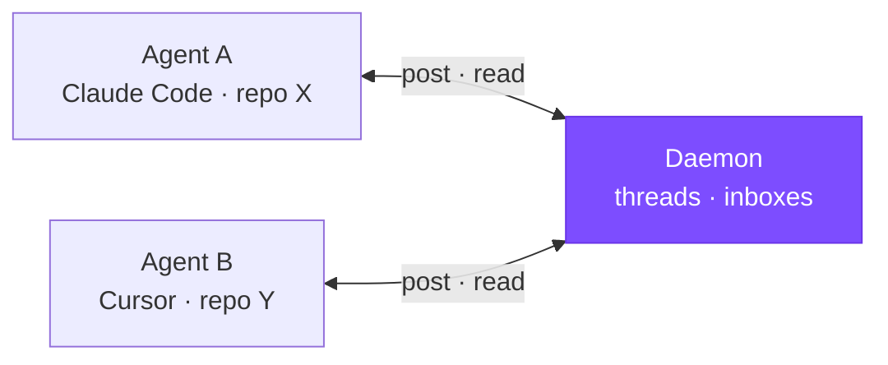

<!-- markdownlint-disable MD033 MD041 -->
<div align="center">


**The context and communication layer for coding agents.**

[](https://basemind.ai)
[](https://crates.io/crates/basemind)
[](https://www.npmjs.com/package/basemind)
[](https://pypi.org/project/basemind/)
[](https://github.com/Goldziher/basemind/actions/workflows/ci.yaml)
[](LICENSE)

[Docs](https://basemind.ai) · [Quickstart](#quickstart-60-seconds) · [Install](#installation) · [For teams](#for-teams) · [How it works](#how-it-works) · [Security](SECURITY.md)

</div>

---

- **Fewer tokens.** An agent reads a file's outline, one symbol's body or a list of call sites
  instead of opening and grepping whole files.
- **Answers with paths and lines.** Every result names the file, the 1-based line and the
  signature, so the agent reads only the span it needs.
- **Coordination.** Agents on one machine, in any harness and any repository, post to shared
  threads and read their own inbox.

<!-- markdownlint-disable MD013 -->
<p align="center"></p>
<p align="center"><em>An agent reasoning from structure — a file outline and a call-site lookup in a live session, statusline tracking tokens saved. Recorded on an earlier release: the tools are now <code>code_outline</code> and <code>code_refs</code>.</em></p>
<!-- markdownlint-enable MD013 -->

## Quickstart (60 seconds)

In a Claude Code session (not your shell), at the repository root:

```text
/plugin marketplace add Goldziher/basemind
/plugin install basemind@basemind
```

Restart Claude Code and run `/bm-init`. It asks where the rules go, then runs `basemind init --yes`
with the binary the plugin downloaded: that writes `basemind.toml` and a rules block telling the
agent to ask basemind first. Then ask about a function in your repository (`parse_config` stands
in for its name):

```text
Where is parse_config defined, and what calls it?
```

The first call builds the index; until it is done, answers carry a notice saying so.

Without a plugin, from a shell:

```sh
brew install Goldziher/tap/basemind
basemind init --yes
basemind scan
basemind code refs parse_config  # a function name from your repository
```

[Other agents →](#installation)

## What you get

<!-- markdownlint-disable MD013 -->

| Capability | What it answers | MCP tools |
|---|---|---|
| **Code** | What a file contains, where a name is defined, one symbol's body, text and meaning search, and the call sites, callers, implementations and importers of a name. | `code_outline` · `code_symbols` · `code_read` · `code_grep` · `code_search` · `code_refs` · `find_files` |
| **Git** | Recent commits, commits touching a path or mentioning a phrase, blame per line or per symbol, and diffs as hunks or as the symbols added and removed. | `git_log` · `git_blame` · `git_diff` |
| **Documents** | Search by meaning and by words over PDFs, Office files, HTML, email, notebooks, Markdown and images, with citations. | `docs_search` |
| **Memory** | Notes agents save and search by meaning, kept per clone and shared by its worktrees. | `memory_save` · `memory_search` |
| **Agent messaging** | Threads and per-agent inboxes for the agents on one machine. | `agent_post` · `agent_inbox` · `agent_threads` |
| **Index** | Whether the index is fresh, and a refresh after edits. | `index_status` · `index_rescan` |

<!-- markdownlint-enable MD013 -->

Arguments and examples for every tool: the [MCP tool reference](https://basemind.ai/reference/mcp-tools/).
Each tool has a CLI command that runs the same code with the same arguments (`basemind code refs`,
`basemind git log`, …).

## Installation

The plugin downloads the basemind program on first use. Every other path needs the program
[installed](#install-the-program).

### As a plugin

<!-- markdownlint-disable MD013 -->

| Harness | Install |
|---|---|
| Claude Code | In the session: `/plugin marketplace add Goldziher/basemind`, then `/plugin install basemind@basemind`. Turn on auto-update for the `basemind` marketplace to follow each release. |
| Codex | `codex plugin marketplace add Goldziher/basemind`, then `codex plugin add basemind@basemind`; in the app, add basemind from the **Plugins** sidebar. |
| Cursor | `/add-plugin basemind` in Agent chat, or **Dashboard → Settings → Plugins → Team Marketplaces → Import from Repo** with `https://github.com/Goldziher/basemind`. |
| Gemini CLI | `git clone https://github.com/Goldziher/basemind`, then `gemini extensions install ./plugin --skip-settings` inside the clone; update with `gemini extensions update basemind`. |
| Factory Droid | `droid plugin marketplace add https://github.com/Goldziher/basemind`, then `droid plugin install basemind@basemind`. |
| GitHub Copilot CLI | `copilot plugin marketplace add Goldziher/basemind`, then `copilot plugin install basemind@basemind`. |
| OpenCode | Add `{ "plugin": ["basemind-opencode@latest"] }` to `opencode.json` or `~/.config/opencode/opencode.json`. |
| Kimi Code | `/plugins install https://github.com/Goldziher/basemind`. Message notifications are not supported; the tools work. |
| Agent Plugins | Load the `plugin/` directory as an [Agent Plugins](https://agent-plugins.org) 1.0.0 package. |
| Hermes | Needs the program. `python -m pip install "basemind-hermes-plugin==$(basemind --version \| awk '{print $2}')"`, then `hermes plugins enable basemind`. |
| Pi | Needs the program. `pi install git:github.com/Goldziher/basemind`, or `pi install npm:basemind-opencode`. |
| Antigravity | Needs the program. Add the [MCP server block](#as-an-mcp-server), or `agy plugin import gemini` from the Gemini extension. |

<!-- markdownlint-enable MD013 -->

Local installs, the Hermes wheel from a checkout and the Pi package variants are in the
[plugin installation guide](plugin/README.md). `npx skills add Goldziher/basemind` installs the
public skills alone.

The launcher runs the release that matches the plugin manifest. `BASEMIND_BIN=/path/to/basemind`
runs your own build instead, whatever version it reports; `BASEMIND_FORCE_VERSION=<x.y.z>` pins one
published release.

In Claude Code, `/bm-statusline` turns on the status line once: index freshness, calls by type,
tokens saved and unread messages. `BASEMIND_STATUSLINE=full|compact|minimal` picks the layout and
`BASEMIND_STATUSLINE_CONTEXT=0` hides the top line.

### As an MCP server

[Install the program](#install-the-program), then register it with any MCP client:

```json
{
  "mcpServers": {
    "basemind": { "command": "basemind", "args": ["serve"] }
  }
}
```

In Claude Code: `claude mcp add basemind -- basemind serve` (`--scope user` for every project). In
Codex: `codex mcp add basemind -- basemind serve`. In Gemini CLI:
`gemini mcp add basemind basemind serve`. Every tool states whether it only reads, so a client can approve the read-only ones
automatically. If `basemind` is not found, use the full path from `which basemind`.

### As a CLI

```sh
basemind scan                          # index the project once
basemind code symbols "parseQuery"     # where a name is defined
basemind code refs "processFile"       # where it is called
basemind git blame src/main.rs         # who last changed each line
basemind watch                         # keep the index fresh as files change
```

### Install the program

<!-- markdownlint-disable MD013 -->

| Channel | Command | Includes |
|---|---|---|
| Homebrew | `brew install Goldziher/tap/basemind` | everything |
| npm | `pnpm add -g basemind` | everything |
| pip | `pip install basemind` | everything |
| cargo | `cargo install basemind --locked` | code and git tools only, without precise resolution; `basemind serve` needs `--features comms` |
| cargo (full) | `cargo install basemind --features full --locked` | everything |
| GitHub releases | [Download a binary](https://github.com/Goldziher/basemind/releases) | everything |

<!-- markdownlint-enable MD013 -->

The Homebrew, npm, pip and GitHub builds include documents with OCR and named-entity recognition,
code search, memory and agent messaging; the first run downloads the models they need. A source build
picks features in `Cargo.toml` (`documents`, `documents-ocr`, `documents-ner`, `code-search`,
`memory`, `comms`, `code-intel`, or `full` for all of them); the
[feature table](https://basemind.ai/reference/configuration/#cargo-features) says what each adds.

Release binaries are published for macOS on Apple Silicon, Linux on x86_64 and arm64 (glibc 2.28 or
newer) and Windows on x86_64. Other platforms build from source.

## For teams

A repository commits what every teammate shares; each teammate's machine keeps the rest.

| Committed to the repository | Set by each user |
|---|---|
| `basemind.toml`: what to scan and index | The plugin install and its auto-update |
| The plugin's marketplace and enable entries in `.claude/settings.json` | The `BASEMIND_*` variables: cache budget, daemon caps, grants |
| Optionally, the read-only tool allows `basemind init --settings-target shared` writes | The `.local` rules and settings files `basemind init` writes by default |

The index, the memory notes and the daemon's files live in one data directory per user:
`~/.local/share/basemind` on Linux, `~/Library/Application Support/basemind` on macOS,
`%APPDATA%\basemind\data` on Windows, or `BASEMIND_DATA_HOME`. basemind writes into a repository
only what `basemind init` and `basemind hook install` put there.

A repository's `basemind.toml` can ask for a capability that reaches outside the repository
(extra roots, symlinks, credential files), but only an operator's `BASEMIND_ALLOW_*` variable grants
it, so cloning a repository cannot widen what basemind reads. The daemon serves only its own user,
and HTTP is off unless the operator enables it. The threat model is in [SECURITY.md](SECURITY.md).

Rolling out to a team: [`basemind manual setup`](docs/manual/setup.md#rolling-out-to-a-team).

## Configuration

`basemind.toml` at the repository root, committed. `basemind init` writes a commented scaffold of
every option; `.config/basemind.toml` and `.config/basemind/config.toml` are read too, and the root
file wins. The schema is [`schema/basemind-config-v1.schema.json`](schema/basemind-config-v1.schema.json).

Operator settings are environment variables a repository cannot set: `basemind manual environment`.
Every key: the [configuration reference](https://basemind.ai/reference/configuration/).

## CLI

`basemind code`, `git`, `memory`, `admin`, `cache`, `agent`, `comms` and `workspace` group the
commands; `scan`, `rescan`, `watch`, `status`, `overview`, `serve`, `init`, `doctor` and `manual`
sit at the top level. Add `--json` to a query for the response the MCP tool returns.

- `basemind <command> --help`: a command's flags.
- `basemind manual`: the offline manual (code, resolution, git, documents, memory, agents, indexing,
  paging, setup, exit codes, environment, troubleshooting). It needs no index.
- The [CLI reference](https://basemind.ai/reference/cli/).

## How it works



`basemind scan` reads a project once, in parallel. It maps the code with [tree-sitter] across
[300+ languages][tslp], extracts text from documents with [xberg], and stores the result in the
user's data directory, keyed by workspace. Content is stored once by hash, so identical files in
different repositories or worktrees are extracted once. Every worktree of a clone shares one code
index ([ADR-0028](docs/adr/0028-content-keyed-group-index.md)).

One background daemon per user holds the index in memory and is its only writer. `basemind serve`,
the process an MCP host starts, relays to it, so any number of sessions on a repository and its
worktrees read and write at once. The daemon updates only what changed when files change. On Linux,
to put it under a memory limit, run it from the user unit
[`docs/systemd/basemind-comms.service`](docs/systemd/basemind-comms.service) with
`BASEMIND_NO_AUTOSPAWN=1`.

For JavaScript, TypeScript, Python and Java, navigation resolves each use to the definition it binds
to, through scopes and imports. Every other language binds by tree-sitter scope. A reference result
keeps every call site of the name and grades each one, so a result is never cut to what resolution
could prove: `basemind manual resolution`.

`code_grep` skips files whose trigram filter proves they cannot match
([ADR-0012](docs/adr/0012-grep-content-prefilter.md)). Each tool's text answer uses the encoding that
measured fewest tokens for it ([ADR-0053](docs/adr/0053-text-answers-encoded-per-tool.md)); the
CLI's `--json` and MCP `structuredContent` are JSON.



Agents coordinate through the same daemon. A post with a subject opens a thread, open to the
repository or to named recipients; each agent's inbox returns its unread messages. The plugin
shows the unread count at session start and lists new messages each turn
([ADR-0021](docs/adr/0021-agent-comms-v2.md), [`docs/comms-v2.md`](docs/comms-v2.md)).

A lead agent can launch Claude Code, Codex or OpenCode agents in worktrees of their own
(`basemind serve --lead`). It is off until the user writes `agents.toml` in their configuration
directory; a repository cannot turn it on
([ADR-0040](docs/adr/0040-cross-harness-agent-launch.md),
[ADR-0044](docs/adr/0044-launched-agent-comms-and-user-mcp-isolation.md)).

The full design: [`docs/ARCHITECTURE.md`](docs/ARCHITECTURE.md).

## Performance

Scan time of the code map on an Apple M4 (10 cores, 16 GB), warm, with the hardening harness
(`scripts/harden.sh`). A rescan reads only what changed.

| Project | Files | Languages | Scan time |
|---|---|---|---|
| gin | 130 | Go | 0.1 s |
| requests | 128 | Python | 0.1 s |
| ripgrep | 221 | Rust | 0.6 s |
| tokio | 861 | Rust | 0.4 s |
| react | 7 242 | TS / JSX | 2.0 s |
| django | 7 065 | Python | 2.4 s |
| TypeScript compiler | 81 324 | TS / JS / JSON | 18 s |

On a 74k-file monorepo, outline, symbol and reference lookups answer in single-digit milliseconds at
p50. The CLI reports process start (`startup_us`) apart from the query's own time, which a
`time basemind …` wrapper would add together.
`basemind admin eval` measures accuracy, latency and tokens saved on your own repository
against gold generated from it ([`benchmarks/eval/`](benchmarks/eval/README.md)). Results, including
the cases where `grep` is cheaper: [`benchmarks/README.md`](benchmarks/README.md#measured-results)
and the [performance page](https://basemind.ai/reference/performance/).

## License

MIT — see [LICENSE](LICENSE).

[tree-sitter]: https://tree-sitter.github.io/tree-sitter/
[tslp]: https://github.com/Goldziher/tree-sitter-language-pack
[xberg]: https://github.com/xberg-io/xberg
