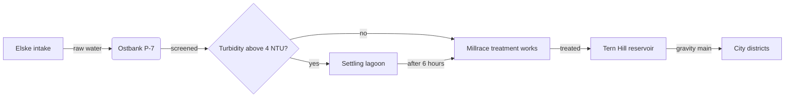

# Varnholt Water Board: Pumping Station Operations

This note describes how the Varnholt Water Board moves water from the Elske River to the taps of
roughly 140,000 residents. It is written for shift operators and for engineers joining the
operations team.

## Network overview

Raw water enters the system at the Ostbank intake, where pumping station P-7 lifts it from the
river channel into the screening house. From there it travels through the Millrace treatment
works, is stored at the Tern Hill reservoir, and reaches the city by gravity. Three further
stations support the network: Quayside, which serves the low-lying harbour district; Hollow
Lane, a booster on the eastern ridge; and Tern Hill itself, which tops up the high-level tank
that feeds the hospital and the northern estates.

## Raw water path

The route raw water takes depends on how cloudy the river is when it arrives. Operators watch
the turbidity meter at the screening house, because the filters at Millrace clog quickly when
the Elske carries silt after heavy rain on the uplands. The flowchart below is the routing
logic the control system follows.

When the reading stays above the threshold, water is diverted into the settling lagoon beside
the intake and held for at least six hours before it is released to Millrace. The lagoon holds
about one and a half days of average demand, so a long spell of muddy river water forces the
board to draw down Tern Hill and to ask large customers to cut back. Operators must log every
diversion, with start and end times, in the station diary.

## Duty and standby rotation

Every station has at least one duty pump and one standby pump. To keep running hours even, the
pumps swap roles each Monday at 08:00 during the morning handover. The outgoing shift records
the hour-meter readings and the incoming shift confirms the standby set starts cleanly before
the swap is accepted. A pump that fails to start is tagged out and reported to the mechanical
fitters on the same day.

## Telemetry and alarms

All five stations report to the central SCADA system over leased lines, with a radio link as
backup. High-priority alarms (loss of suction, motor overtemperature, reservoir low-low level)
page the on-call engineer directly. In 2024 the board's R&amp;D group fitted acoustic leak
loggers to the trunk main between Millrace and Tern Hill; the trial found two leaks in its
first month, and the loggers are now being extended across the network under the joint
R&amp;D programme with the regional university.

## Energy use

Pumping is the board's largest electricity cost. Tern Hill is filled mainly during the night
tariff window between 23:00 and 06:00, and daytime pumping is limited to what is needed to
hold the reservoir above forty per cent.
